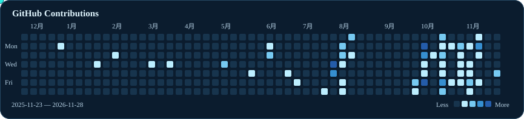

我用 Java 探索 AI Agent 工程，也用 Python 做数据和 Web 项目。

## 代表项目

<table width="100%">
  <tbody>
    <tr>
      <td width="33%" valign="top">
        <a href="https://github.com/jackfeicoder/codeMate"><strong>codeMate</strong></a>
         用 Java 实现的 AI Agent 命令行工具
      </td>
      <td width="33%" valign="top">
        <a href="https://github.com/jackfeicoder/hzf-blog"><strong>hzf-blog</strong></a>
         用 React、FastAPI 和 SQLite 搭建的个人博客
      </td>
      <td width="34%" valign="top">
        <a href="https://github.com/jackfeicoder/Kronos"><strong>Kronos</strong></a>
         股票预测模型实验，接入国内数据并做中文可视化
      </td>
    </tr>
  </tbody>
</table>

`Java` · `Python` · `React` · `FastAPI` · `SQLite`

## 贡献日历

